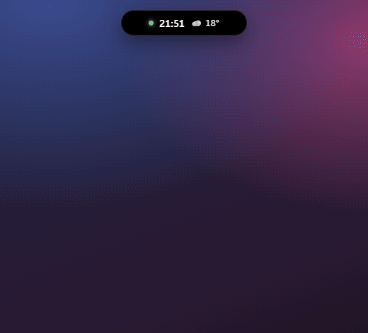
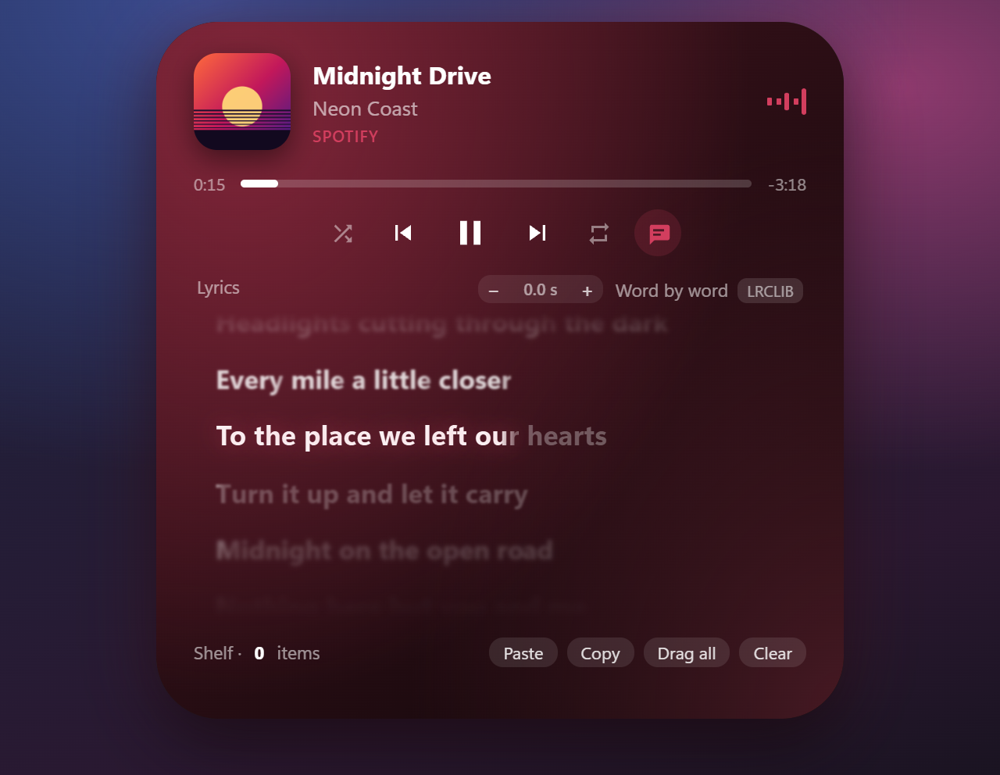
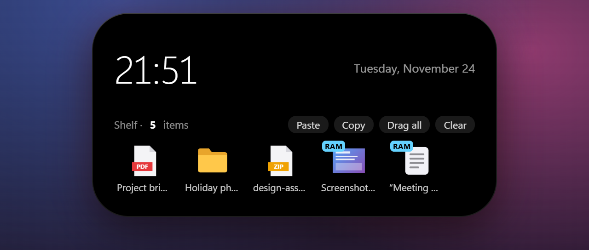

# Atoll Island


An animated **Dynamic Island / Now Bar** for Windows 10 and 11 **and macOS 13 Ventura or later** (see [macOS](#macos)), written in pure **Rust + [Tauri 2](https://tauri.app)**. A compact pill sits at the top center of your screen and springs open for media, lyrics, notifications, volume, a file shelf, downloads and more. **No Electron, no PowerShell.**

> **Beta:** Features are tested in daily use. If you find a bug or have an idea, please open an issue.

<p align="center"></p>

## Screenshots

| | |
|:---:|:---:|
| <br>**Expanded player** with artwork-tinted background | <br>**Word-by-word synced lyrics** |
| <br>**Notifications** | <br>**Incoming call card** |
| <br>**Two sources** (main pill + bubble) | <br>**Volume** (replaces the Windows OSD) |
| <br>**Idle** clock and weather | <br>**Download progress** (Steam / browsers) |
| <br>**Drop files** onto the island | <br>**Shelf + clipboard history** (files, screenshots, text) |

<sub>Screenshots are rendered from the real UI with sample data; the track, artwork and messages are made up.</sub>

---

## Installation

### 1. MSI installer (recommended)
Download the latest `.msi` installer (`en-US` or `tr-TR`) from the [Releases](../../releases) page and run it.
- Creates a Start Menu shortcut and an Add/Remove Programs entry.
- Installs WebView2 automatically if it is missing (it ships with Windows 11).

### 2. Build from source
Requirements: Windows 10/11, [Rust](https://rustup.rs) (stable), Visual Studio C++ Build Tools, Node.js (only for packaging the `.msi`).

```powershell
git clone https://github.com/UgurYorulmaz1/Atoll-Island.git
cd Atoll-Island\src-tauri

# Build the executable only:
cargo build --release

# Build the MSI installer:
npx @tauri-apps/cli@2 build --bundles msi
```

---

## macOS

Native port for **macOS 13 Ventura and later** (universal binary: Apple Silicon + Intel). Same UI, same settings, all 12 languages; the platform layer lives in `src-tauri/src/macos/`.

### What is different on the Mac
- **Notch-aware:** on MacBooks with a notch the idle island covers the notch exactly and the compact player puts the artwork and the equalizer on both sides of it. On other displays the island hangs from the top edge of the screen over the menu bar (set *Top offset* above 0 for the floating Windows look).
- **Every Space, over fullscreen apps:** the island sits above the menu bar, follows you to every desktop and over fullscreen apps; *Auto-hide in fullscreen* hides it until the cursor touches the top edge.
- **Menu bar app:** no Dock icon. The menu bar icon (a template image, so it adapts to light/dark menu bars) opens Settings, *Open at Login* and *Quit*. After you click the island, keyboard focus goes back to the app you were typing in.
- **Media:** Apple Music and Spotify through their AppleScript dictionaries (play/pause, next/previous, seek, shuffle, repeat, artwork). With Apple Music playing, the island's panels also offer a **heart** that favorites the track, an **AirPlay** device picker (click switches the output, ⌥-click adds a device for multi-room) and **library search** with click to play. **Up Next** lists the following tracks of the playing playlist, or of the album when Music does not report a playlist. The expanded view shows where the track is **playing from**. A native **⋯ menu** (also on right-click of the heart) adds the track to a playlist, sets a star rating, marks it *Suggest Less* or shows it in Music. None of these need an account or an API key. Other players (Safari, Chrome, Podcasts, VLC, IINA ...) through the system Now Playing service on macOS 13 to 15.3.
- **Volume HUD:** with Accessibility access the volume keys show the island instead of the macOS HUD, in the same 1/16 steps; hold **⌥⇧** for fine 1/64 steps. Right-click the speaker for the quick output switcher (Mac speakers ↔ AirPods ↔ display).
- **Shelf:** **Quick Look** previews (PDF pages, video frames, documents), native drag out to Finder, Mail, Messages and browsers, `⌘V` paste. Clipboard history honours the nspasteboard.org privacy markers, so 1Password, Bitwarden, KeePassXC and similar managers stay out of it.
- **Downloads:** Safari downloads show a real percentage, read from the `.download` package. Chrome, Edge, Brave, Arc, Vivaldi and Opera use their History database, and Steam and Epic are also supported.
- **System monitor:** CPU, RAM (counted like Activity Monitor), network, and GPU load and temperature from IOKit on Apple, AMD, Intel and NVIDIA GPUs. Microphone and camera dots come from CoreAudio and CoreMediaIO. The screen-recording dot covers OBS and QuickTime recordings.
- **Batteries:** AirPods (lowest of left and right), Beats, and Magic Keyboard, Mouse and Trackpad.
- **Shortcut:** **⌃⇧Space** toggles the island. It uses the Carbon hot-key API, so it needs no permission.

### Permissions (all optional)
| Permission | Used for | Where |
|---|---|---|
| Automation → Music / Spotify | now playing + controls | asked automatically on first use |
| Accessibility | volume keys show the island instead of the system HUD | Settings → General → *Open Settings* |
| Full Disk Access | mirroring Notification Center banners (macOS keeps them in a private database) | Settings → General → *Open Settings* |
| Downloads folder | download progress | asked when *Download progress* is turned on |

### Build on macOS
Requirements: macOS 13+, Xcode Command Line Tools, [Rust](https://rustup.rs) stable.

```bash
cd src-tauri
cargo install tauri-cli --version "^2" --locked      # once
rustup target add aarch64-apple-darwin x86_64-apple-darwin
cargo tauri build --target universal-apple-darwin --bundles app,dmg
```

The `.app` and `.dmg` are written to `src-tauri/target/universal-apple-darwin/release/bundle/`. The build is ad-hoc signed. On first launch, right-click the app and choose **Open**, or run `xattr -dr com.apple.quarantine "/Applications/Atoll Island.app"`.

### Known limits on macOS
- Since macOS 15.4, Apple only lets Apple-signed apps read the system Now Playing service. On those versions Apple Music and Spotify keep working through AppleScript; browser and other players do not appear.
- The microphone and camera dots cannot name the app that uses the device, because macOS has no public API for that.

---

## Features

### Media, music and Spotify
- **Live media controls (SMTC):** Album art, background that follows the cover color, animated equalizer bars, play/pause, previous/next, shuffle/repeat and a draggable progress bar for Spotify, Apple Music, YouTube Music and browsers. Apple Music seeking works through UI Automation.
- **Two sources (Now Bar):** When two players run at once, the main pill shows one and a small bubble shows the other; click the bubble to swap them.
- **Single source mode (optional):** Pauses the previous player when a new one starts.
- **Synced lyrics ([LRCLIB](https://lrclib.net)):** Apple Music style word-by-word or line-by-line lyrics. Click a line to jump there; fine-tune the timing with `− / +`.
- **Spotify Web API (optional; basic media controls work without it):**
  - Like (heart), view the play queue and jump straight to any track in it
  - Search Spotify from the island, add to queue (`+`) and an **`∞ Similar`** autoplay toggle
  - **Spotify Connect:** One-click switching between PC, phone and speakers

### Notifications, calls and volume
- **Expandable Windows notifications:** Notifications appear in the island; **click to expand** and read long messages, **Open app** brings the right window to the front, or dismiss.
- **Incoming call card:** Live call card for WhatsApp, Telegram, Teams and Discord voice/video calls.
- **Volume:** Windows volume keys show in the island instead of the standard Windows OSD. Scroll to change volume, drag the volume bar, and right-click the speaker icon for a quick **audio output switcher** (speakers ↔ headphones).

### Shelf and clipboard
- **Drag-and-drop file shelf:** Drag files from the desktop or Explorer onto the island, keep them there, then drag them anywhere (`SHDoDragDrop`). Stored on disk or in RAM with a configurable size limit.
- **Clipboard history:** Text, screenshots and files you copy with `Ctrl+C` land on the shelf automatically (password managers are excluded).

### Downloads, weather and stats
- **System-wide download tracker:**
  - **Chrome / Edge / Brave / Opera** (real `%` and speed from the local `History` SQLite database), plus **Steam** and **Epic Games**.
  - A progress ring next to the compact pill, a list of up to **5** downloads when expanded, and an open / add-to-shelf notification when finished.
- **Weather and rain alert:** Temperature next to the clock while idle, and a warning if rain starts within the hour ([Open-Meteo](https://open-meteo.com), no API key).
- **Listening history and weekly summary:** Daily and weekly listening time, a 7-day chart, and your top artists and tracks.

### Hardware, system and privacy
- **Live system and gaming monitor:** CPU, NVIDIA GPU temperature and load, RAM, and download/upload speed.
- **Wireless device batteries:** Headphone, keyboard and mouse battery levels over Bluetooth Classic and **BLE GATT (`0x180F`)**, plus a headphones-connected alert.
- **Privacy and recording dots:** Microphone (orange) and camera (green) indicators, and a screen-recording indicator for OBS and Xbox Game Bar.

### Customization, languages and performance
- **Zero idle cost and GPU acceleration:** Background features that are turned off never wake up and use **0 CPU / 0 disk / 0 network**. WebView2 GPU rasterization and hardware acceleration are supported.
- **12 languages:** Turkish, English, German, French, Spanish, Italian, Portuguese, Russian, Arabic, Japanese, Korean and Chinese (including context and tray menus and localized dates).
- **Simple / Advanced mode and customization:** A one-switch simple Settings view, category tabs and setting search. Background style (Black / Glass / Dark Gray), accent color, top offset (`0–48 px`), idle opacity and Auto-Dim, Windows-matched or custom scaling (`75–115%`), animation speed, `24h / 12h` clock, multi-monitor selection and one-click reset.

---

## Connecting Spotify (optional)

1. Create an app at [developer.spotify.com/dashboard](https://developer.spotify.com/dashboard).
2. Add `http://127.0.0.1:8989/login` as a **Redirect URI**.
3. Copy the app's **Client ID**, paste it into **Atoll Island → Settings → Spotify** and click **Connect with Spotify**.

> Note: Spotify requires the account owner to have **Premium** for apps in development mode. No `client secret` is needed; sign-in uses PKCE.

---

## Tech stack

- **Backend:** Rust (2021), Tauri 2, `windows` 0.62 (Win32 / WinRT: SMTC, Core Audio, UI Automation, SetupAPI, UserNotificationListener, Shell/OLE), `tokio`, `reqwest`, `rusqlite`
- **Frontend:** Plain HTML5 / CSS3 / vanilla JavaScript (no framework)

## Privacy

- Settings, the shelf and statistics are stored only on your computer (`%APPDATA%\com.island.dynamic`, on macOS `~/Library/Application Support/com.island.dynamic`).
- For lyrics, only the track title, artist and duration are sent to LRCLIB.
- When weather is on, `ipwho.is` is used for approximate location and `Open-Meteo` for the forecast.
- Spotify features talk to the Spotify Web API only after you connect your account.

## License

[GPL-3.0](LICENSE)
