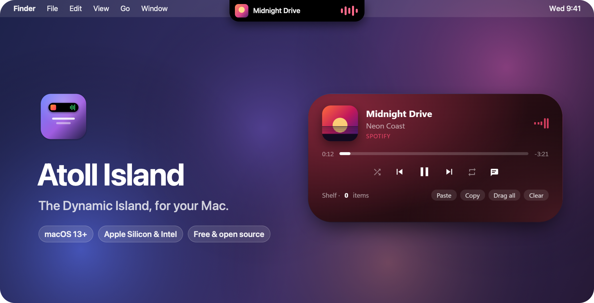
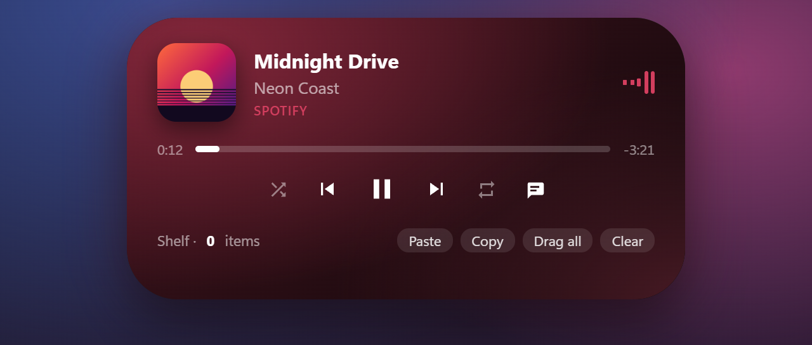
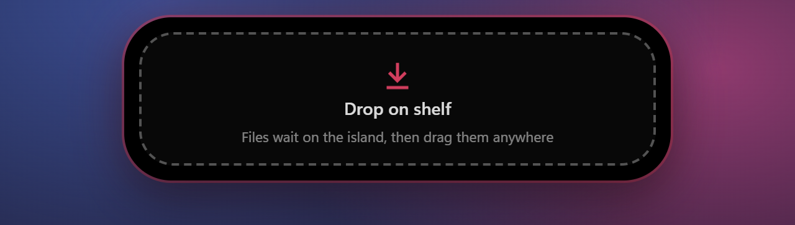
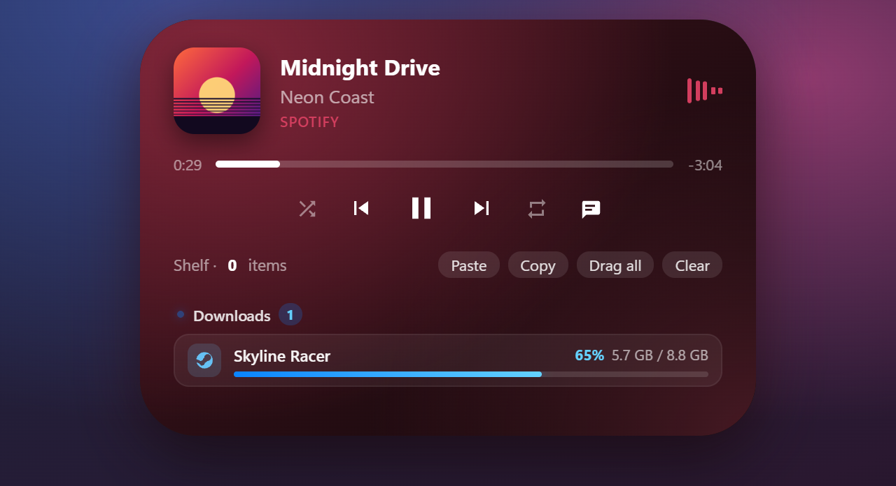

<p align="center">
  
</p>

<p align="center">
  A pill at the top of your screen that springs open for music, lyrics, notifications, volume, AirPlay, a file shelf, downloads and more.<br>
  Native, tiny and free. Written in <b>Rust + <a href="https://tauri.app">Tauri 2</a></b>, with no Electron.
</p>

<p align="center">
  <a href="https://github.com/UgurYorulmaz1/Atoll-macOS/releases/latest/download/Atoll-Island_0.1.0_macOS_universal.dmg"></a>
</p>

<p align="center">
  <a href="https://github.com/UgurYorulmaz1/Atoll-macOS/releases/latest"></a>
  
  
  
  
  <a href="LICENSE"></a>
</p>

<p align="center">
  <a href="#-features">Features</a> ·
  <a href="#-apple-music">Apple Music</a> ·
  <a href="#-made-for-the-mac">Made for the Mac</a> ·
  <a href="#-install">Install</a> ·
  <a href="#-permissions">Permissions</a> ·
  <a href="#-faq">FAQ</a> ·
  <a href="#-build-from-source">Build</a>
</p>

<p align="center">
  
</p>

---

## ✨ Features

<table>
  <tr>
    <td width="50%" valign="top">
      
      <h4>Now playing, beautifully</h4>
      The artwork tints the island, the equalizer moves to the beat, and you can scrub, shuffle and repeat. Works with Apple Music and Spotify, and on macOS 13 to 15.3 also with Safari, Chrome, Podcasts, VLC and IINA.
    </td>
    <td width="50%" valign="top">
      
      <h4>Synced lyrics, word by word</h4>
      Lyrics from <a href="https://lrclib.net">LRCLIB</a> scroll along line by line or word by word. Click a line to jump there, and nudge the timing with <code>−</code> / <code>+</code>.
    </td>
  </tr>
  <tr>
    <td valign="top">
      
      <h4>Notifications</h4>
      New Notification Center banners appear on the island. Click to expand long messages, open the app or dismiss.
    </td>
    <td valign="top">
      
      <h4>Incoming calls</h4>
      A live call card for FaceTime, WhatsApp, Telegram, Teams, Zoom and Discord. It closes by itself when the call is answered or missed.
    </td>
  </tr>
  <tr>
    <td valign="top">
      
      <h4>A better volume HUD</h4>
      The volume keys show the island instead of the system HUD; hold <kbd>⌥</kbd><kbd>⇧</kbd> for fine steps. Scroll to change the volume, or right-click the speaker to move between the Mac, AirPods and your display.
    </td>
    <td valign="top">
      
      <h4>Two sources at once</h4>
      When two players run together, a small bubble shows the second one; click it to swap them. With <i>Single source</i> mode, starting one player pauses the other.
    </td>
  </tr>
  <tr>
    <td valign="top">
      
      <h4>Drop files on the island</h4>
      Drag anything from Finder onto the island to park it there. Files are kept on disk or in RAM, with a size limit you set.
    </td>
    <td valign="top">
      
      <h4>Shelf and clipboard history</h4>
      Quick Look previews, drag out to Finder, Mail or Messages, and <kbd>⌘</kbd><kbd>V</kbd>. Copied files, screenshots and text land here; password managers are left out.
    </td>
  </tr>
  <tr>
    <td valign="top">
      
      <h4>Downloads</h4>
      Real progress for Safari, Chrome, Edge, Arc, Brave, Vivaldi and Opera, plus Steam and Epic. When a download finishes, open it or add it to the shelf.
    </td>
    <td valign="top">
      
      <h4>Clock, weather and rain alerts</h4>
      While idle, the island shows the time and temperature, and warns you when rain is about to start (<a href="https://open-meteo.com">Open-Meteo</a>, no account needed).
    </td>
  </tr>
</table>

<sub>Screenshots are rendered from the real UI with sample data; the tracks, artwork and messages are made up.</sub>

---

## 🎵 Apple Music

Apple Music gets the same extras as Spotify, without any extra account or API key.

| | |
|---|---|
| ❤️ **Favorite** | Heart the playing song straight from the island. It stays in sync with the Music app. |
| 📡 **AirPlay** | Pick HomePod, Apple TV or any AirPlay speaker. <kbd>⌥</kbd>-click to add more rooms. |
| 🔎 **Library search** | Search your library from the island and click a result to play it. |
| 📜 **Up Next** | See what comes next in the playlist or album, and jump to any track. |
| 🏷️ **Playing from** | The expanded view shows which playlist the song is playing from. |
| ⋯ **More menu** | A native menu to add the song to a playlist, rate it with stars, mark it *Suggest Less* or show it in Music. |

> [!TIP]
> Spotify gets its own extras too: like, queue, search, autoplay of similar songs and Spotify Connect. See [Connecting Spotify](#-connecting-spotify-optional).

---

## 🍎 Made for the Mac

<table>
  <tr>
    <td width="33%" valign="top"><b>Hugs the notch</b><br>On MacBooks with a notch, the idle island covers it exactly, and the compact player puts the artwork and equalizer on either side. On other displays it hangs from the top edge like a virtual notch.</td>
    <td width="33%" valign="top"><b>Always there</b><br>Above the menu bar, on every Space and over fullscreen apps. <i>Auto-hide in fullscreen</i> brings it back when the cursor touches the top edge.</td>
    <td width="33%" valign="top"><b>Never in the way</b><br>Clicks pass through everywhere except the island itself. After you click it, keyboard focus goes back to the app you were typing in.</td>
  </tr>
  <tr>
    <td valign="top"><b>A real menu bar app</b><br>No Dock icon. The menu bar icon adapts to light and dark menu bars and offers Settings, <i>Open at Login</i> and Quit.</td>
    <td valign="top"><b>Quick Look everywhere</b><br>Shelf items show real previews: PDF pages, video frames and documents.</td>
    <td valign="top"><b>Your hardware, live</b><br>CPU, RAM, network, and GPU load and temperature on Apple, AMD, Intel and NVIDIA GPUs. AirPods and Magic Keyboard, Mouse and Trackpad batteries.</td>
  </tr>
  <tr>
    <td valign="top"><b>Privacy dots</b><br>Orange when a microphone is in use and green for the camera, plus a red dot while OBS or QuickTime is recording.</td>
    <td valign="top"><b>One shortcut</b><br><kbd>⌃</kbd><kbd>⇧</kbd><kbd>Space</kbd> opens the island from anywhere, and it needs no permission.</td>
    <td valign="top"><b>Light on resources</b><br>Features you turn off never wake up and use no CPU, disk or network. It is a universal binary, native on Apple Silicon and Intel.</td>
  </tr>
</table>

<details>
<summary><b>And more…</b></summary>

- **12 languages:** Turkish, English, German, French, Spanish, Italian, Portuguese, Russian, Arabic, Japanese, Korean and Chinese, including menus and dates.
- **Simple or advanced Settings** with category tabs and search.
- **Customization:** black, glass or dark gray background, accent color, top offset (0–48 px), idle opacity with Auto-Dim, size or custom scale (75–115%), animation speed, 24h or 12h clock, and a choice of display.
- **Listening stats:** daily and weekly listening time, a 7-day chart, and top artists and tracks, stored only on your Mac.

</details>

---

## 📦 Install

1. **Download** [`Atoll-Island_0.1.0_macOS_universal.dmg`](https://github.com/UgurYorulmaz1/Atoll-macOS/releases/latest/download/Atoll-Island_0.1.0_macOS_universal.dmg) and drag **Atoll Island** into **Applications**.
2. **First launch:** the app is free and not notarized by Apple, so right-click it and choose **Open** once. Or run:
   ```bash
   xattr -dr com.apple.quarantine "/Applications/Atoll Island.app"
   ```
3. **Done.** The island appears at the top of the screen, and its icon sits in the menu bar. Click the icon for Settings.

> [!NOTE]
> Requires **macOS 13 Ventura or later** on Apple Silicon or Intel.

## 🔐 Permissions

All permissions are optional. The island works without them; each one unlocks one feature.

| Permission | What it unlocks | How |
|---|---|---|
| **Automation** → Music / Spotify | Now playing and playback controls | macOS asks on first use |
| **Accessibility** | Volume keys show the island instead of the system HUD | Settings → General → *Open Settings* |
| **Full Disk Access** | Notification Center banners on the island | Settings → General → *Open Settings* |
| **Downloads folder** | Download progress | macOS asks when you turn the feature on |

## 🔗 Connecting Spotify (optional)

Basic controls work without this. Connecting adds like, queue, search and Spotify Connect.

1. Create an app at [developer.spotify.com/dashboard](https://developer.spotify.com/dashboard).
2. Add `http://127.0.0.1:8989/login` as a **Redirect URI**.
3. Paste the app's **Client ID** into **Atoll Island → Settings → Media**, press **Save**, then **Connect with Spotify**.

Spotify requires the account owner to have **Premium** for apps in development mode. No client secret is needed, because sign-in uses PKCE.

---

## ❓ FAQ

<details>
<summary><b>Why does macOS say the app is from an unidentified developer?</b></summary>

Atoll Island is free and open source and is not notarized with a paid Apple Developer account. Right-click the app and choose **Open** once, or use the `xattr` command from [Install](#-install).
</details>

<details>
<summary><b>Why don't songs from Safari, Chrome or YouTube show up?</b></summary>

Since macOS 15.4, Apple only lets Apple-signed apps read the system's Now Playing information. On macOS 13 to 15.3 browsers and other players appear. On newer versions Apple Music and Spotify keep working, because they are read directly.
</details>

<details>
<summary><b>Why does the island need Full Disk Access for notifications?</b></summary>

macOS has no public API for reading other apps' notifications. Atoll Island reads Notification Center's own database, read-only, and that file is protected. Without the permission everything else still works.
</details>

<details>
<summary><b>Does it work on Macs without a notch?</b></summary>

Yes. On other displays the island hangs from the top edge of the screen over the menu bar. Set **Top offset** above 0 if you prefer it floating below the edge.
</details>

<details>
<summary><b>Is there a Windows version?</b></summary>

Yes: <a href="https://github.com/UgurYorulmaz1/Atoll-Island">Atoll Island for Windows 10 and 11</a>. This repository builds both, and the Windows code lives next to the macOS layer.
</details>

<details>
<summary><b>Why can't the privacy dots tell me which app uses the microphone?</b></summary>

macOS reports that a microphone or camera is in use, but has no public API that names the app. The system's own indicator in Control Center shows it.
</details>

---

## 🛠 Build from source

Requirements: macOS 13 or later, Xcode Command Line Tools and [Rust](https://rustup.rs) stable.

```bash
git clone https://github.com/UgurYorulmaz1/Atoll-macOS.git
cd Atoll-macOS/src-tauri
cargo install tauri-cli --version "^2" --locked          # once
rustup target add aarch64-apple-darwin x86_64-apple-darwin
cargo tauri build --target universal-apple-darwin --bundles app,dmg
```

The `.app` and `.dmg` are written to `src-tauri/target/universal-apple-darwin/release/bundle/`. For a quick debug run, use `cargo run`.

<details>
<summary><b>How the code is organized</b></summary>

| Path | What |
|---|---|
| `ui/` | The island and Settings UI: plain HTML, CSS and JavaScript, with no framework |
| `src-tauri/src/macos/` | macOS layer: window and notch, CoreAudio, media, notifications, pasteboard, Quick Look, sysmon |
| `src-tauri/src/applemusic.rs` | Apple Music extras: favorite, AirPlay, search, Up Next and the ⋯ menu |
| `src-tauri/src/*.rs` | Shared features (settings, shelf, Spotify, lyrics, weather, stats, downloads) and the Windows layer |
| `src-tauri/tauri.macos.conf.json` | macOS bundle settings: minimum version, signing, DMG |

The same module names exist on both systems. On macOS, `main.rs` swaps in the files from `src/macos/` with `#[cfg_attr(target_os = "macos", path = …)]`.

**Built with:** Rust 2021, Tauri 2, objc2 (AppKit, Foundation), CoreAudio, CoreMediaIO, IOKit, CoreGraphics, MediaRemote, QuickLookThumbnailing, ServiceManagement, `tokio`, `reqwest` and `rusqlite`.
</details>

## 🔒 Privacy

- Settings, the shelf and statistics stay on your Mac, in `~/Library/Application Support/com.island.dynamic`.
- For lyrics, only the track title, artist and duration are sent to LRCLIB.
- With weather turned on, `ipwho.is` gives an approximate location and Open-Meteo the forecast.
- Spotify features talk to the Spotify Web API only after you connect your account.
- Notification Center is read locally and read-only; nothing leaves your Mac.

## 📄 License

[GPL-3.0](LICENSE). Bug reports and ideas are welcome in [Issues](https://github.com/UgurYorulmaz1/Atoll-macOS/issues).
